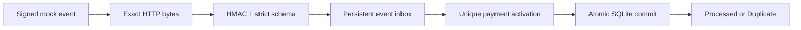

# Webhook Guardian

**Authenticated mock webhooks. Persistent protection for local SQLite effects.**

Community Edition **v0.1.0** is a small TypeScript receiver that verifies signed
mock payment events and prevents repeated local payment activations—even when an
HTTP response is lost and the sender redelivers the event.

The problem is simple: webhook delivery can repeat, while business effects should
not. Guardian separates event identity from the payment business key and commits
both the local effect and its completion record in one SQLite transaction.



## What is implemented

- `POST /webhooks/mock-payment` with a versioned mock event schema.
- HMAC-SHA256 over exact request bytes, timing-safe comparison and a 16 KiB body limit.
- Strict payload validation and sanitized machine-readable outcomes.
- Persistent event deduplication and rejection of conflicting event-ID reuse.
- A separate payment business key preventing activation through different event IDs.
- Transactional rollback, restart persistence and controlled process-death tests.
- Separate-process concurrency and SQLite writer-lock verification.
- A Python standard-library simulator and an isolated one-command demo.

Guardian processes **mock data only**. It does not call external APIs or process real payments.

## Quick start

Requires **Node.js 24.15+ within the 24.x LTS line**, npm, and **Python 3.9+** for the
demo. Built-in `node:sqlite` is release candidate in the supported Node range;
[Node's SQLite runtime requirements](https://nodejs.org/download/release/latest-v24.x/docs/api/sqlite.html)
apply. Windows and Ubuntu 24.04 WSL have been exercised; hosted CI results are
available only after the workflow actually runs.

```text
npm ci
npm run demo
```

No `.env`, API keys, external services or Python packages are needed for the demo.
It builds the app, creates a fresh temporary database and random development secret,
starts a real Guardian HTTP child on an OS-assigned loopback port, waits for readiness,
and invokes the existing Python simulator. It never opens your configured database.
Both the simulator and the parent check persisted state; the parent reopens SQLite
**after server shutdown**. Owned processes exit before temporary files are removed.

Expected output for a successful run (computed and asserted, not hardcoded results):

```text
Webhook Guardian - Reliability Demo
Deliveries: 100
Unique Event IDs: 10
Processed Events: 10
Duplicate Deliveries: 90
Business Activations: 10
Rejected Invalid Signatures: 1
HTTP Attempts: 101
State Verification: SQLite verified (this run only)
Verification: PASS
Persistence: 10 completed inbox rows and 10 activation rows verified after server exit
Cleanup: PASS
```

HTTP attempts can exceed 101 if the sender retries an explicit 503. Startup, HTTP,
simulator and cleanup waits are bounded. Failed assertions or cleanup return nonzero.
The runner discovers `python3`, `python` or the Windows `py -3` launcher. To select
an executable explicitly:

```powershell
$env:PYTHON = 'C:\path\to\python.exe'
npm run demo
```

```sh
PYTHON=python3 npm run demo
```

### Run the normal server

Copy [.env.example](.env.example) to `.env` (`Copy-Item` in PowerShell or `cp` in a
POSIX shell). Generate a random development secret:

```text
node -e "console.log(require('node:crypto').randomBytes(32).toString('hex'))"
```

Put it in `MOCK_WEBHOOK_SECRET`, then:

```text
npm run build
npm start
```

The normal executable loads `.env` and binds `127.0.0.1:3000`. Optional settings are
`HOST`, `PORT`, and `DATABASE_PATH`. An absent database setting explicitly selects
`./guardian.sqlite`; empty/whitespace paths, `:memory:` and SQLite `file:` URIs are
rejected. The database parent directory must exist. Persistence requires a suitable
local filesystem with working SQLite locking and sync support; network shares are
unsupported. In-memory factory storage is intended for isolated tests only.

Secrets must contain at least 32 UTF-8 bytes and cannot be whitespace-only. Length
validation does not prove cryptographic strength. Never use production credentials
for this mock receiver. Signing secrets and internal exception details are not logged.

## Mock event and signature contract

All five fields below are required; extra properties are rejected. IDs contain
1–128 ASCII letters, digits, underscores or hyphens. `occurredAt` is a UTC ISO date-time
with `Z`. Event types match `^[a-z][a-z0-9_.-]{0,63}$`.

```json
{
  "schemaVersion": "1",
  "eventId": "evt_demo_001",
  "eventType": "payment.completed",
  "occurredAt": "2026-10-12T12:00:00Z",
  "paymentId": "pay_demo_001"
}
```

Only `payment.completed` activates a payment. Other valid event types are persisted
as unsupported and return `UnsupportedEvent` on every retry. Invalid requests are
not persisted. Bodies must be UTF-8 JSON with `Content-Type: application/json`.

`X-Mock-Signature: v1=<64 hexadecimal characters>` contains HMAC-SHA256 with the
configured secret over the **exact transmitted body bytes**. Both hexadecimal cases
are accepted. Signature verification precedes JSON decoding and schema validation;
size-limit rejection may happen first. Digests are compared with `timingSafeEqual`
after strict format/length validation. Do not reserialize a body after signing.

The [versioned sample](examples/payment-completed.v1.json) and [Node sender](scripts/send-mock.mjs)
show exact-file-byte signing. With the normal server running:

```text
node --env-file=.env scripts/send-mock.mjs
node --env-file=.env scripts/send-mock.mjs
```

The second identical delivery returns `Duplicate`. This is a mock signing protocol,
not a Stripe, Shopify or PayPal protocol.

## HTTP outcomes

Responses contain `outcome`; only `Processed` adds `activationCreated`.

| HTTP | Outcome | Meaning |
| --- | --- | --- |
| 200 | `Processed` | New event completed. Activation created only when `activationCreated` is true. |
| 200 | `Duplicate` | Identical completed event already recorded. |
| 401 | `InvalidSignature` | Missing, malformed or incorrect signature. |
| 400 | `InvalidPayload` | Invalid JSON, UTF-8, schema or malformed body. |
| 413 | `InvalidPayload` | Body exceeds 16 KiB. |
| 415 | `InvalidPayload` | Content type is not application/json. |
| 409 | `EventConflict` | Existing event ID reused with changed validated content. |
| 422 | `UnsupportedEvent` | No supported operation for this valid event type. |
| 503 | `ProcessingFailed` | Internal processing/storage failure; sender-managed retry required. |

Unknown routes use Fastify's normal 404. A generic 503 does not identify its internal
cause. Only test workers classify SQLite BUSY/LOCKED privately; external callers
receive no database codes or sensitive exception details.

## Persistence and idempotency

**Event-level deduplication:** `inbox.event_id` is a primary key. Canonical validated
content ignores JSON whitespace/key order; changed values, including timestamp
spelling, conflict with an existing ID.

**Business-level idempotency:** `payment_activations.payment_id` is a separate primary
key. A second event ID for an already activated payment completes with
`activationCreated: false`.

Both protections run under `BEGIN IMMEDIATE`. Inbox insertion, activation and completion
share one transaction, and success follows COMMIT. Exceptions roll back active
transactions; secondary cleanup errors preserve the original failure. Processing
state is never independently committed. A manually damaged/preexisting processing
row fails closed and requires inspection. Severe storage or rollback failures may
require restart and database inspection.

SQLite uses WAL, synchronous FULL and a five-second busy timeout. It serializes writers
sharing the file. SQLite work and lock waits block that process's Node event loop.
Guardian has no retry worker: the sender retries failures and lost acknowledgements.

See the [architecture](docs/architecture.md) and [reliability evidence](docs/reliability.md).

## Verification and CI

```text
npm run build
npm run typecheck
npm test
python -B -m unittest discover -s examples/python-simulator -v
npm audit
npm run demo
```

Reliability coverage includes separate processes sharing one database, event and
payment uniqueness, a held writer lock, restart persistence, transactional rollback,
and forced child termination immediately before/after confirmed COMMIT. Crash tests
reuse the real Inbox transaction in a test-only worker; they do not interrupt a live
HTTP handler or prove resilience to physical power loss.

The [CI workflow](.github/workflows/ci.yml) runs on push and pull requests using
Ubuntu 24.04, Node 24 and Python 3.12. Official actions are pinned to full commit SHAs,
token permissions are read-only, checkout credentials are not persisted, and no
secrets or database/log uploads are required. Any build, test, audit or demo error
fails the job. Local/WSL verification is not a hosted CI success claim.

You can also run the [Python simulator](examples/python-simulator/simulator.py) against
an existing local mock server. Set `MOCK_WEBHOOK_SECRET` in that terminal; Python does
not load `.env`. `--database` enables independent read-only verification for that
run. Without it, the summary explicitly reports API-only verification. Per-event and
per-payment checks reject incorrect outcome distributions even when aggregate totals
match. See `--help` and [simulator details](docs/reliability.md#python-simulator).

## Security and operational limits

This is a Community foundation, **not a production-readiness claim**. Its guarantee
covers local SQLite effects while records are retained. It does not guarantee
exactly-once webhook delivery or protection for external API side effects.

There is no TLS termination, rate limiting, secret rotation, replay-age check,
retention cleanup, backup tooling, recovery queue, dashboard or monitoring service.
`occurredAt` is validated but is not a trusted freshness assertion. Protect the
secret, database and WAL files. Deleting data removes duplicate protection.

## Roadmap

Community work remains focused on mock ingestion, reproducible demonstrations and
verification. Future provider/backend integrations, recovery and observability work
would require separate design and validation; no such adapters are included today.

## Need a custom integration?

Professional services may include Stripe, Shopify or other provider-specific webhook
integration; existing Node.js, Python or .NET backend integration; business-specific
idempotency; retry/recovery design; and observability with staging validation.
These are potential custom services, distinct from the current Community features.
No provider adapters are claimed to exist in this repository.

## Contributing and issue reporting

Keep changes small and preserve the documented signing, HTTP and transaction contracts.
Run the complete verification commands before proposing a change. Open a repository
issue with a sanitized reproduction, Node/Python versions, OS and expected/actual
outcomes. Never include signing secrets, production payloads or private database files.

See the [changelog](CHANGELOG.md) and [draft v0.1.0 release notes](docs/release-notes-v0.1.0.md).
The project is licensed under [MIT](LICENSE).
