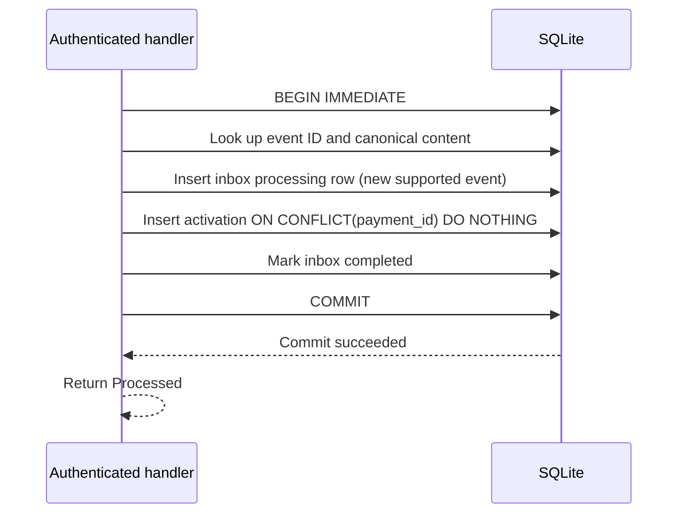

# Architecture

Webhook Guardian Community v0.1.0 is a mock receiver with local transactional
idempotency. It uses Fastify, strict TypeScript, Zod, Node crypto and built-in SQLite.

```mermaid
flowchart LR
    Sender[Mock sender] --> Raw[Raw HTTP bytes: max 16 KiB]
    Raw --> HMAC[HMAC-SHA256 verification]
    HMAC --> Schema[Strict version-1 event validation]
    Schema --> Inbox[SQLite inbox transaction]
    Inbox --> Activation[Unique local payment activation]
    Activation --> Commit[Commit inbox completion and activation]
    Commit --> Response[Machine-readable HTTP outcome]
```

## Source responsibilities

| Module | Responsibility |
| --- | --- |
| [app.ts](../src/app.ts) | Buffer body bytes, authenticate, decode and validate, map outcomes to HTTP. |
| [security.ts](../src/security.ts) | Secret configuration checks and timing-safe HMAC verification. |
| [handler.ts](../src/handler.ts) | Strict event schema, canonical content and local activation SQL. |
| [inbox.ts](../src/inbox.ts) | Persistent tables and transaction boundaries. |
| [server.ts](../src/server.ts) | Executable environment validation, binding and shutdown. |

## Authentication boundary

The signature is `X-Mock-Signature: v1=<64 hex characters>`. HMAC-SHA256 authenticates
the exact received body buffer before JSON decoding. Strict signature parsing makes
both digests the same length for `timingSafeEqual`. Missing, malformed and incorrect
signatures all return `401 InvalidSignature`. Size limits may reject before HMAC.
No signing secret or internal crypto/database exception is exposed in application logs.

Schema version `1` requires eventId, eventType, occurredAt and paymentId. Extra fields
are rejected. Only payment.completed has a business operation; other valid event
types reserve identity in the inbox and return UnsupportedEvent on every retry.

## Event deduplication versus business idempotency

`inbox.event_id` identifies a delivery event. Canonical validated content makes
formatting/key-order differences equivalent. Reusing its ID with changed fields
returns EventConflict. A completed identical event returns Duplicate.

`payment_activations.payment_id` independently identifies the local business effect.
Two different event IDs may complete for one payment, but only the first inserts an
activation. The second returns Processed with activationCreated=false.

## Atomic transaction

Identity checking also occurs under the writer transaction. Existing events and
unsupported events take explicit branches before business mutation. Processing
state is never independently committed. Failures roll back when a transaction
remains active; cleanup failures preserve the original processing exception.
COMMIT failures do not return success. There is no application-level retry loop.

SQLite WAL, synchronous FULL and a five-second busy timeout are configured. Writers
share one local file and are serialized by SQLite. Database operations and lock
waits are synchronous and block that process's Node event loop. Detected internal
failures return generic 503 ProcessingFailed; ordinary clients cannot determine
whether the cause was a lock or another failure. Senders must retry with backoff.

## Runtime and storage boundary

Requires Node.js 24.15+ within the 24.x LTS line. Built-in node:sqlite is release
candidate in this supported range; runtime stability requirements still apply.
The normal executable rejects empty/whitespace paths, :memory: and SQLite URIs.
An absent DATABASE_PATH selects ./guardian.sqlite. The application factory supports
memory databases for isolated tests. Persistent storage requires a suitable local
filesystem with working locking and sync semantics; network shares are unsupported.

## Demo and verification boundary

[run-demo.mjs](../scripts/run-demo.mjs) builds an isolated SQLite file and starts the
same production app through [demo-server.mjs](../scripts/demo-server.mjs) in a child
process on an OS-assigned loopback port. The wrapper supplies the temporary database
and generated secret; it provides readiness and shutdown IPC, with no HTTP control
or fault-injection endpoint. The simulator verifies outcomes and stored rows, and
the parent independently reopens the file after server exit before removing it.

Reliability fault injection exists only in test workers excluded from the production
build. Crash tests pause actual Inbox code immediately before or after COMMIT, kill
that owned worker and inspect reopened storage. They test process termination, not
physical power loss. See [reliability evidence](reliability.md).

## Explicit limits

The guarantee covers local SQLite business effects while records are retained.
It does not cover external API side effects or exactly-once webhook delivery.
No real payments, provider adapters, queues, recovery workers or monitoring services
exist in Community. Production readiness is not claimed.
